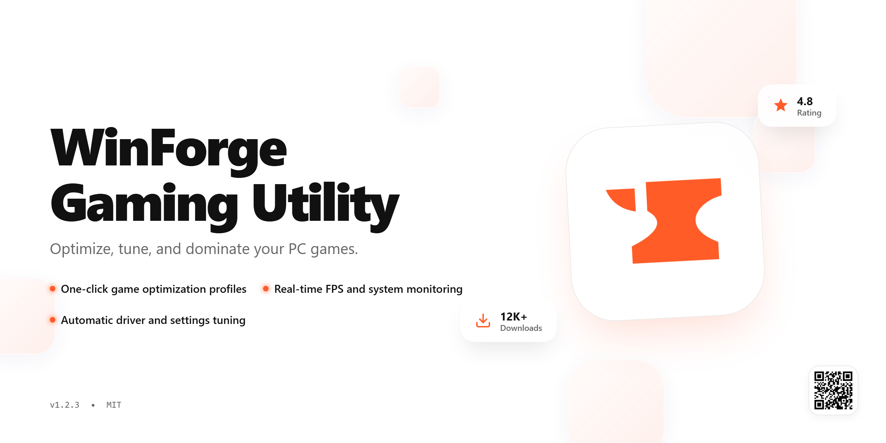

# WinForge Gaming Utility — Open-Source Hardware Control for Windows 11

### ⚡ PowerShell Setup Button

     

---

WinForge Gaming Utility is a Windows desktop application that consolidates hardware control, live telemetry, and per-game tuning into a single native interface. It applies process priority, power plan, core affinity, and I/O scheduling rules at game launch and reverts them on exit, with sensor-driven monitoring and an in-game metrics overlay for real-time validation. The application operates entirely under a permissive open license and is available at no cost to end users, with the full source distributed alongside each build. Optional modules—including timer resolution control, USB polling adjustment, and fan curve management—extend the core tuning surface through an in-app component manager.

## ✅ Before You Start

- Windows 10 or Windows 11
- PowerShell 5.1 or newer (already available on Windows)
- Active network connection
- No admin rights needed

## Features

## Features

**⚙️ Automatic Game Mode**
WinForge detects when a game launches and applies a preconfigured optimization profile: process priority adjustments, background service throttling, and power plan switching. When the game exits, every change is reverted to its prior state. No manual toggling, no residual configuration.

**🕹️ Unified Game Library**
Games are discovered from Steam, Epic, GOG, Xbox, and other launchers, along with emulator installations, and presented in a single managed library. Each title supports per-game rules covering CPU priority, GPU priority, I/O priority, core affinity, power plan, Windows Defender exclusions, and Control Flow Guard — all configured from one panel and applied at launch.

**📊 Real-Time Sensor Monitoring**
Live telemetry for CPU, memory, network throughput, temperatures, voltages, and clock speeds, grouped by hardware device and expandable by category. An in-game metrics overlay surfaces performance data during play, controlled through keyboard shortcuts.

**⚡ Core and Power Management**
Granular control over processor behavior: selectable power plans, turbo ceiling adjustment (boost and performance limit) with default and recommended profiles, per-core affinity assignment, and per-core utilization monitoring.

**🧠 Windows Tuning Hub**
A centralized optimization interface spanning ten categories — privacy, power, gaming, updates, notifications, sound, Explorer, startup, taskbar, and theme — with hundreds of individual tweaks, a recommended baseline profile, and ready-made presets. The same hub hosts advanced network and TCP configuration, debloat operations, system repair, Windows Update management, device cleanup, and startup management.

**🧰 Integrated Utilities**
A bundled toolset covering macro recording and playback, a configurable autoclicker, cache and registry cleanup, power plan management, DNS configuration, and system repair routines.

**🧩 Workshop and Installable Components**
An in-app catalog of every capability WinForge offers — both built-in core sections and optional installable modules. Components can be installed, updated, or removed without leaving the application. Available modules include timer resolution adjustment, USB polling rate tuning, keyboard repeat delay and key filtering, automatic RAM cache cleanup, an expanded sensor monitor, per-channel PWM fan curves with temperature-sensor binding, a system process manager, stability stress testing, macros, and an autoclicker. Shared driver dependencies are managed centrally from the Drivers settings page, where they can be installed, repaired, or uninstalled independently of the components that reference them.

**🌐 Multilanguage Interface**
Twenty languages available out of the box or as installable language packs, covering regions across the Americas, Europe, and Asia.

**🔄 Self-Updating Distribution**
The installer is fully self-contained, requiring no separate runtime installation. The application checks for and applies updates from within its own Settings panel, with every release built automatically from the project source.

## How it works

WinForge operates through a layered architecture that separates detection, policy definition, and system-level application, so tuning stays predictable and reversible.

**Game detection and profile activation.** A background watcher enumerates running processes and matches them against a local database of executables belonging to game libraries and emulators. When a match is found, WinForge attaches the corresponding per-game rule set — CPU and GPU priority, I/O priority, power plan, core affinity, Windows Defender exclusion, and Control Flow Guard — and applies it to the running session. When the process exits, every modified value is restored to its prior state from a stored snapshot, so the system returns to baseline without manual cleanup.

**System tuning engine.** The optimization hub is driven by a declarative catalog of tweaks organized into categories: privacy, power, gaming, updates, notifications, sound, Explorer, startup, taskbar, and theme. Each entry describes its target (registry key, service, scheduled task, or policy), its accepted values, and a recommended default. Applying a preset resolves the catalog into a concrete operation plan, executes it with elevated privileges, and records what changed. Because the catalog is declarative rather than hardcoded, individual entries can be reverted independently of the preset that applied them.

**Monitoring pipeline.** Sensor data, CPU and memory counters, and network throughput are collected on a polling loop and surfaced through a grouped, expandable view. Readings are organized by device and category, with the update cadence tuned to keep overhead low during gameplay. The in-game metrics overlay renders the same data over a running title and is toggled through global keyboard shortcuts.

**Component model.** Core sections ship with the application; optional capabilities live in the Workshop as installable components. Each component declares its dependencies, so the app can resolve and verify shared drivers before enabling the features that rely on them. Components can be installed, updated, or removed from within the app, and shared dependencies remain visible and manageable through the dedicated drivers panel even when no installed component currently uses them.

**Privilege and state handling.** WinForge elevates on launch because its operations touch system-level configuration. All mutations are journaled, which enables the revert-on-exit behavior of Game Mode, per-tweak rollback, and the system repair tooling to operate from a consistent record of original values rather than assumptions about defaults.

## Compatibility

WinForge targets 64-bit Windows 10 and Windows 11, with validation performed on Windows 11 25H2. The application elevates on launch, since its tuning operations write to system-level settings; an administrator account is therefore required for the full feature set. The installer is self-contained and carries no external runtime dependencies, so no separate.NET or Windows App SDK installation is needed. Updates are delivered and applied from within the app.

Hardware coverage is broad rather than board-specific. Sensor monitoring and fan curve control draw on the shared PawnIO driver; whenever that dependency is absent, the affected page surfaces a notice pointing to Settings → Drivers while continuing to display every reading that does not depend on it. USB polling-rate adjustment relies on the hidusbf driver, which is managed from the same Drivers panel independently of the components that reference it. Per-game rules — CPU and GPU priority, I/O priority, power plan, core affinity, Defender exclusion and Control Flow Guard — apply to titles detected from Steam, Epic, GOG, Xbox and comparable launchers, as well as to emulators.

The Workshop model keeps compatibility predictable: core sections ship with the build, while optional components such as timer resolution, USB overclocking, the key filter, memory cleanup, sensor monitor, fans, process management, stability test, macros and autoclicker are installed, updated or removed from within the app, so the footprint matches the machine it runs on. The metrics overlay and the 3D scene benchmark remain in development and are marked accordingly in the catalog.

## FAQ

**Is WinForge really zero cost?**
Yes. Every optimization feature ships unlocked, with no tiers, trials, or feature gates. The project is open source, and the source is available for inspection and contribution.

**Does WinForge require administrator privileges?**
Yes. WinForge elevates on launch because it modifies system-level settings: power plans, process priorities, core affinity, service states, and registry values. Without elevation, most tuning operations would silently fail.

**Which Windows versions are supported?**
Windows 10 and Windows 11, x64 only. The current build is validated against Windows 11 25H2. Older builds may work but are not officially tested.

**Will WinForge conflict with anti-malware or kernel-level anti-cheat systems?**
WinForge operates on documented Windows APIs and does not inject into game processes or modify game memory. Per-game rules adjust scheduler priorities, affinity, and power plans from the outside. If a title's anti-tamper layer flags any external utility, exclude the WinForge process in that title's configuration rather than disabling protections.

**What happens if the app closes or crashes mid-session?**
Game Mode applies its changes transactionally and reverts processes, services, and the power plan when the monitored game exits. If the app is terminated unexpectedly, use the Restore Defaults action in the tuning hub to return the affected subsystems to their captured baseline.

**Are the applied tweaks reversible?**
Yes. Every optimization records its prior state before writing, and each category in the tuning hub exposes a per-item revert alongside the recommended profile. System Restore points are created automatically before bulk preset application.

**Does WinForge collect telemetry?**
No. Sensor readings, game library scans, and configuration data stay local. The only network activity is the update check against the project's own release channel, which can be disabled in Settings → Updates.

**How are installable components and shared drivers handled?**
Components live in the Workshop and can be installed, updated, or removed independently. Shared dependencies (the sensor and fan driver, and the USB polling driver) are managed centrally under Settings → Drivers, so they remain visible and repairable even after the components that use them are removed.

**Can per-game rules target launchers and emulators, not just executables?**
Yes. The game library detects titles across major launchers and emulator frontends, and rules bind to the resolved executable. Priority, affinity, power plan, I/O priority, and Defender exclusion are all configurable per title.

**Does the app need a separate runtime installed?**
No. The installer is self-contained; no.NET or Windows App SDK installation is required. Updates are delivered in-app from Settings → Updates.

## Disclaimer

WinForge is provided as a system-level tuning utility for Windows 10 and 11 x64. It operates with elevated privileges and intentionally modifies core system behavior, including process scheduling, power management, network stacks, service states, and registry configuration. These changes are applied by design and are reversible through the application's own controls, but they are not without consequence.

By launching WinForge, you acknowledge the following:

**Administrative scope.** The application elevates on launch and requires sustained administrator access to perform its functions. Any configuration change it makes carries the same weight as one made manually through Windows system tools.

**Hardware interaction.** Components that interface with drivers — including sensor monitoring, fan control, and USB polling adjustment — communicate directly with hardware through third-party drivers. Incorrect curves, thresholds, or polling values can cause instability, thermal stress, or device misbehavior. Validate every profile against your specific hardware before relying on it during gameplay or sustained workloads.

**System state.** Optimization profiles alter service states, scheduled tasks, update behavior, and privacy settings. Applying a preset is a deliberate system modification, not a cosmetic one. Record your original configuration before applying changes so you can restore it if needed.

**No fitness guarantee.** WinForge is supplied "as is," without warranty of any kind, express or implied, including warranties of merchantability, fitness for a particular purpose, and non-infringement. The authors and contributors accept no liability for data loss, hardware damage, performance regression, software conflict, or any direct, indirect, incidental, or consequential damages arising from use of the application.

**User responsibility.** You are responsible for the profiles you apply, the drivers you install through Settings → Drivers, and the compatibility of those choices with your hardware and software environment. Test on a non-critical system first, keep current backups, and revert changes you cannot account for.

**Distribution integrity.** Obtain WinForge only from its official project channels. Builds acquired from third parties may have been altered and are not covered by this notice or by the project's license.

Use WinForge with the same care you would apply to any tool that writes to system configuration.

## License

WinForge is released under the MIT License. The full license text is included in the repository root as `LICENSE`, and it governs all source code, binaries, and associated documentation distributed with the project. Under these terms, you are permitted to use, copy, modify, merge, publish, distribute, sublicense, and sell copies of the software, provided the original copyright notice and this permission notice are retained in all copies or substantial portions of the software.

The software is provided "as is", without warranty of any kind, express or implied, including but not limited to the warranties of merchantability, fitness for a particular purpose, and noninfringement. In no event shall the authors or copyright holders be liable for any claim, damages, or other liability, whether in an action of contract, tort, or otherwise, arising from, out of, or in connection with the software or its use.

For users who modify or extend WinForge, the MIT License imposes no obligation to publish derivative works. However, contributors who wish to upstream changes back to the official project are asked to submit them under the same license so the codebase remains uniformly distributable. Redistributions that include modified binaries should clearly identify the changes made and must not misrepresent the software as an official WinForge build.

The WinForge name and icon are project identifiers used to designate the official distribution maintained by WithinMindtaurus. Forks and derivative distributions are welcome under the terms of the license, but they should use a distinct name and iconography to avoid confusion about origin and support.

Third-party components that WinForge installs, references, or interfaces with may carry their own licenses. Where such components are distributed alongside WinForge, their respective license terms apply to those components independently of the MIT License covering WinForge itself. Users are responsible for reviewing those terms before installing or using such components.